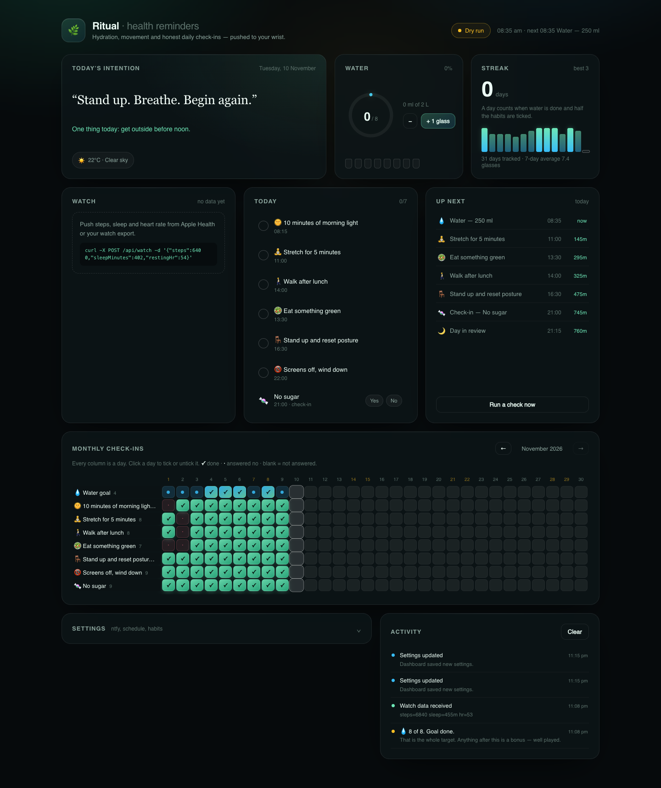
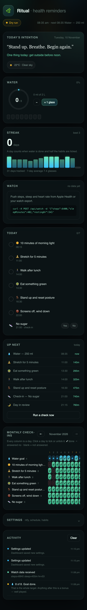
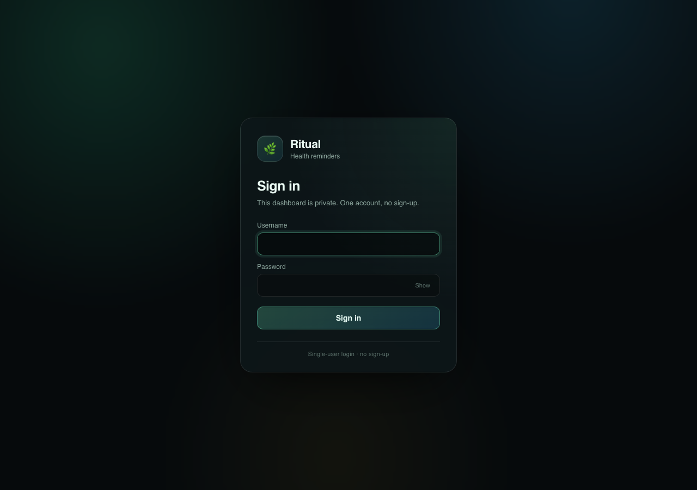

# Ritual — health reminders on your wrist

A tiny self-hosted health companion: daily motivation, water tracking, movement nudges,
habit reminders, and **yes/no check-ins with a monthly grid**. It publishes to
[ntfy](https://ntfy.sh), which your phone mirrors to a smartwatch through the Zepp app.

No account, no subscription, no npm dependencies. Your data stays in `./data`.



<p align="center"></p>

*Screenshots use demo data.*

---

## Features

| | |
| --- | --- |
| ☀️ Daily intention | A deterministic quote + one focus per day. |
| 💧 Water | Goal, glass logging, progress ring, interval nudges, goal celebration. |
| 🚶 Movement | Interval nudges with steps; skipped when the step goal is already met. |
| 🌿 Habits | Timed nudges (sunlight, stretch, posture, screens-off…), fully editable. |
| ✅ Check-ins | Yes/no confirmation notifications; the answer ticks that exact date. |
| 📅 Monthly grid | Every habit × every day, clickable to backfill or correct. |
| 🔥 Streaks | Derived from history, so imported days count. |
| ⌚ Watch data | Steps, sleep, resting HR and calories via `POST /api/watch`. |
| 🌦️ Weather context | Optional live weather from a `weather-ntfy` state file. |
| 🔔 Notification buttons | “+1 glass”, “✅ Yes”, “❌ Not today” via token-protected `/a/*`. |
| 🔐 Login | Single-user session login, no sign-up. |
| 📤 Export | CSV of all days, habits and metrics. |
| 📱 PWA | Add to Home Screen; standalone dark dashboard. |

---

## How it works

```
watch ⇄ Zepp app ⇄ Zepp cloud / Apple Health
                         │
                         ├── export / Shortcut ──► POST /api/watch
                         │
Ritual (Node) ──► ntfy ──► phone notification ──► Zepp mirroring ──► watch
      │
      ├── data/*.json (config, state, history, logs)
      └── web dashboard + login + monthly grid
```

Ritual runs as a single Node process (or one Docker container). ntfy can be
[ntfy.sh](https://ntfy.sh) or self-hosted.

---

## Requirements

- Node **18.17+** (tested on 20 and 22), or Docker + Docker Compose
- An ntfy topic (public or self-hosted)
- Optional: a smartwatch/phone that mirrors ntfy notifications (Zepp for Amazfit)

---

## Quick start (local)

```bash
git clone https://github.com/Dhivyadhanush/ritual.git ritual
cd ritual
cp .env.example .env

# pick a password and copy the printed hash into .env
node scripts/hash-password.mjs "change-me"

# edit .env:
#   AUTH_USER=admin
#   AUTH_PASSWORD_HASH=scrypt:...
#   NTFY_TOPIC=my-ritual-7f3a
#   HEALTH_BASE_URL=http://127.0.0.1:4322

npm start
```

Open <http://127.0.0.1:4322> and sign in with `AUTH_USER` / your password.

- `NTFY_DRY_RUN=true` is the default: reminders are logged, not sent. Set it to `false`
  after you subscribe to the topic.
- If `AUTH_USER` and `AUTH_PASSWORD_HASH` are both empty, the app runs without a login
  (useful for local development only).

Run the tests:

```bash
npm test
```

---

## Homebrew (macOS)

Ritual runs well as a Homebrew service on a Mac that stays awake:

```bash
brew tap Dhivyadhanush/tap
brew install ritual

# Create a password hash and paste it into the config when prompted below
ritual hash-password "change-me"

# Edit AUTH_USER, AUTH_PASSWORD_HASH, NTFY_TOPIC, NTFY_URL and HEALTH_BASE_URL
open -e "$(brew --prefix)/etc/ritual.env"

brew services start ritual
```

Open <http://127.0.0.1:4322>. The service stores its data in
`$(brew --prefix)/var/ritual` and loads configuration from
`$(brew --prefix)/etc/ritual.env` on every start.

Useful commands:

```bash
brew services restart ritual
brew services info ritual
tail -f "$(brew --prefix)/var/log/ritual.log"
brew services stop ritual
```

`HEALTH_BASE_URL` must be an address your phone can reach. For notification
buttons, use HTTPS on a public domain; `http://127.0.0.1:4322` only works while
the phone is on the same Mac.

---

## Docker

```bash
cp .env.example .env
# edit .env (AUTH_USER, AUTH_PASSWORD_HASH, NTFY_TOPIC, HEALTH_BASE_URL)

docker compose up -d --build
docker compose ps
```

The container publishes `${PORT:-4322}`, runs as `${PUID:-1000}:${PGID:-1000}`, mounts
`./data:/data`, and has a `/api/health` healthcheck.

### Use a containerized ntfy

If ntfy runs in Docker on a shared network, add a `compose.override.yaml`:

```yaml
services:
  ritual:
    networks:
      - homenet

networks:
  homenet:
    external: true
```

Then set `NTFY_URL=http://ntfy:80` in `.env`. `compose.override.yaml` is gitignored.

### Optional weather context

Mount a `weather-ntfy` state file read-only:

```yaml
services:
  ritual:
    volumes:
      - /path/to/weather-ntfy/data/state.json:/weather/state.json:ro
    environment:
      WEATHER_STATE_FILE: /weather/state.json
```

Without it, weather-specific wording is simply skipped.

---

## Configuration

Copy `.env.example` to `.env`. Env values seed the **first** boot; after
`data/config.json` exists, the dashboard is the source of truth.

| Variable | Default | Purpose |
| --- | --- | --- |
| `PORT` | `4322` | HTTP port |
| `HOST` | `127.0.0.1` (`0.0.0.0` in Docker) | Bind address |
| `PUID` / `PGID` | `1000` | Container UID/GID that owns `data/` |
| `DATA_DIR` | `./data` (`/data` in Docker) | Config, state, history, logs |
| `NTFY_URL` | `https://ntfy.sh` | ntfy server |
| `NTFY_TOPIC` | — | Topic name |
| `NTFY_TOKEN` | — | Bearer token for protected ntfy |
| `NTFY_DRY_RUN` | `true` | Log instead of sending |
| `NTFY_MIN_PRIORITY` | `3` | Priority floor |
| `HEALTH_BASE_URL` | — | Public URL for notification buttons |
| `HEALTH_NAME` | `there` | Name used in messages |
| `HEALTH_WAKE` / `HEALTH_SLEEP` | `07:00` / `22:30` | Day window |
| `HEALTH_WATER_GOAL` | `8` | Glasses per day |
| `HEALTH_STEP_GOAL` | `8000` | Steps per day |
| `AUTH_USER` | — | Single-user login username |
| `AUTH_PASSWORD_HASH` | — | scrypt hash (`scrypt:salt:hash`) |
| `HEALTH_WATCH_TOKEN` | — | Required by `POST /api/watch` |
| `ACTION_TOKEN` | — | Protects `/a/water` and `/a/checkin` |
| `DASHBOARD_USER` / `DASHBOARD_PASS` | — | Legacy plaintext fallback (dev only) |
| `WEATHER_STATE_FILE` | — | Optional weather snapshot |

---

## Login (single user, no sign-up)



There is no registration, user table, or password-reset email. One account is configured
on the server.

```bash
node scripts/hash-password.mjs "your new password"
# scrypt:<salt>:<hash>  → AUTH_PASSWORD_HASH
```

- Sessions: random 32-byte ID, 7 days, `HttpOnly`, `SameSite=Lax`, `Secure` behind HTTPS.
  Sessions live in memory, so a restart logs you out.
- 8 failed attempts per IP / 15 minutes are rejected.
- `POST /logout` (header button) destroys the session.
- `/api/*` and static files require the session. `/api/health` and `/icon.svg` are public
  for healthchecks. `/a/*` uses `ACTION_TOKEN`, not the login, so notification buttons work
  without a session.
- No default credentials are included in this repository; `.env` is gitignored.
- To change the password, update `AUTH_PASSWORD_HASH` and restart the process/container.

---

## Connect ntfy to your watch

1. Pick a hard-to-guess topic and put it in `NTFY_TOPIC`.
2. Subscribe to it in the ntfy app on your phone (`ntfy.sh` or your server).
3. In the Zepp app: **Devices → your watch → Notification and Reminders → App
   Notification** → enable **ntfy**.
4. Press **Send test** in Ritual and check the watch.

For custom button URLs, set `HEALTH_BASE_URL` to an address the phone can reach (LAN IP,
Tailscale name, or a public HTTPS URL). The app uses `/a/water` and `/a/checkin` with
`ACTION_TOKEN`; these paths bypass the login by design.

> **After changing `HEALTH_BASE_URL`, notifications already in your shade keep the old
> URL.** Dismiss them and send a new test. Prefer HTTPS: iOS/Android may block cleartext
> HTTP actions.
>
> On iOS, ntfy does not always dismiss the notification after an `http` action (known
> `clear:true` issue), so it can look like nothing happened. Check the dashboard — the
> request still ran.

If you expose the app on a public domain, see **[docs/DOMAIN.md](docs/DOMAIN.md)** for
Cloudflare Tunnel + optional Cloudflare Access. When using Access, bypass only `/a/*`.

---

## Check-ins and the monthly grid

A habit with `"checkin": true` behaves differently from a nudge:

1. At its scheduled time Ritual sends **“Did you keep ‘…’ today?”**
2. The notification has **✅ Yes** and **❌ Not today** buttons.
3. Answering writes the value for that date and updates the monthly grid.
4. No answer → a pending banner on the dashboard and a line in the evening recap.

The grid is interactive: click any past cell to tick or untick it. Empty past days are
created on demand.

Add or edit habits in **Settings → Habits & check-ins**: emoji, label, time, type
(*Nudge* or *Check-in*).

---

## Watch and health data

All routes end at `POST /api/watch` or the history importer.

### API

```bash
curl -X POST http://127.0.0.1:4322/api/watch \
  -H 'Content-Type: application/json' \
  -H 'X-Watch-Token: <token>' \
  -d '{"steps":6840,"sleepMinutes":455,"restingHr":53,"activeCalories":388}'
```

Set a token in **Settings → Watch data** (or `HEALTH_WATCH_TOKEN`). Without it, the
endpoint is open.

### Apple Health / iPhone

Enable **Zepp → Apple Health** first. Then use a Shortcuts automation (“Find Health
Samples” → “Get Contents of URL”) or an exporter app to POST the JSON above.

### Zepp / Amazfit export

Request your data from Zepp (Settings → Security & Privacy → Export data, or the
[Zepp privacy page](https://www.zepp.com/privacy-support)). Rename the columns to the
importer's names and run:

```bash
npm run import -- ~/Downloads/zepp-export.csv
```

Columns (case-insensitive, spaces/underscores):

```
date, steps, sleep_minutes, resting_hr, active_calories, water, goal,
sunlight, stretch, walk, veggies, posture, screens
```

One column per habit id is optional. Existing days are **merged**, not replaced.
Restart the server afterwards so it reloads `data/history.json`. JSON arrays also work.

The app uses the data to show the Watch card, skip movement nudges when steps are done,
soften the morning message after short sleep, and add context to water nudges/recap.

---

## Deployment

### Docker host

On the server:

```bash
git clone https://github.com/Dhivyadhanush/ritual.git ritual
cd ritual
cp .env.example .env
# edit .env
docker compose up -d --build
```

Update later with `git pull && docker compose up -d --build`.

`scripts/deploy-server.sh` is an optional rsync helper:

```bash
HOST=user@server DEST=/home/user/ritual ./scripts/deploy-server.sh
```

It preserves the remote `.env`, `data/`, and `compose.override.yaml`.

### macOS (launchd)

```bash
npm run deploy      # installs ~/Library/LaunchAgents/com.ritual.health.plist
npm run undeploy
```

The plist runs `node server.js`, restarts on failure, and writes logs to
`~/Library/Logs/ritual.log`.

### Public domain

Use a reverse proxy or Cloudflare Tunnel. For Cloudflare Tunnel, the public hostname
should point at the Docker host gateway, e.g. `http://172.17.0.1:4322` when cloudflared is
a bridge container. Full walkthrough: **[docs/DOMAIN.md](docs/DOMAIN.md)**.

---

## API

| Method | Path | Purpose |
| --- | --- | --- |
| `GET` | `/api/health` | Liveness (public) |
| `GET` | `/api/bootstrap` | Config (tokens masked), today, summary, weather, upcoming, pending, month |
| `PUT` | `/api/config` | Save settings (validated/clamped) |
| `POST` | `/api/water?delta=1` | Add/remove a glass |
| `PUT` | `/api/habit` | `{ id, done, date? }` |
| `GET/POST` | `/api/checkin?id=&done=1&date=` | Dashboard check-in |
| `GET/POST` | `/a/water?delta=1&t=…` | Token-protected notification button |
| `GET/POST` | `/a/checkin?id=&done=&date=&t=…` | Token-protected check-in button |
| `POST` | `/api/watch` | Ingest steps/sleep/HR/calories |
| `POST` | `/api/check` | Run the scheduler now |
| `POST` | `/api/test` | Send/log a test notification |
| `GET` | `/api/month?month=YYYY-MM` | Month data for the grid |
| `GET` | `/api/history?days=60` | Archived days |
| `GET` | `/api/export.csv` | CSV export |
| `DELETE` | `/api/logs` | Clear the activity log |
| `GET` | `/login` | Login page |
| `POST` | `/login` | Create a session |
| `POST` | `/logout` | Destroy the session |

Unknown habits/dates return `404`; bad payloads `400`. Tokens are never returned to the
browser (`tokenSet` only).

---

## Data and backups

```
data/config.json    settings, mode 0600 (may contain ntfy/watch tokens)
data/state.json     today's water, habits, watch snapshot, nudge timestamps
data/history.json   archived days (up to 730)
data/logs.json      last 200 reminder events
```

Back up `data/` (and `.env`) and you have everything. `data/`, `.env`, and
`compose.override.yaml` are gitignored. No credentials are committed to this repository.

---

## Tests

```bash
npm test
```

13 tests cover bootstrap, water, check-ins, backfill, watch ingest/token, CSV export,
action-token endpoints, login/session/logout, and error handling. Each test starts an
isolated server with a temporary data directory.

---

## Helio Strap and the heartbeat sensor

The **Amazfit Helio Strap** is a screenless BioTracker 6.0 band: per-second HR, SpO2,
stress, sleep stages/breathing quality, sleep HRV, recovery, VO2 max, training load, live
BLE HR broadcast, 5 ATM, ~10 days battery, no subscription. This repo's
**[docs/HELIO-STRAP.md](docs/HELIO-STRAP.md)** covers 15 things to track beyond the usual
steps/workouts: orthostatic tests, resonance-breathing biofeedback, strength-set HR
recovery, heat-strain hydration, sleep regularity, illness radar, alcohol/caffeine
response, and more — with feasibility and safety notes.

> Not a medical device. These are wellness experiments; do not use them to diagnose
> anything.

---

## Roadmap

- macOS menu bar item (water, next nudge, streak)
- iPhone companion (HealthKit reader; Amazfit BLE pairing is private, so no direct watch link)
- Zepp OS mini-app for on-watch screens
- Helio live-HR mode (standard BLE Heart Rate service) for orthostatic/breathing tests
- Import presets for real Zepp export column names

---

## Troubleshooting

| Symptom | Check |
| --- | --- |
| Login always fails | Password case; use the Show toggle. The form accepts pasted `username: … / password: …` lines. |
| Nothing on the watch | Is ntfy enabled in Zepp **App Notification**? Is the phone in DND? |
| Test says “dry run” | Set `NTFY_DRY_RUN=false` and restart/save. |
| Notification buttons do nothing | `HEALTH_BASE_URL` must be reachable from the phone (use HTTPS). Old notifications keep the old URL — send a new test. |
| iOS notification stays after Yes/No | Known ntfy `clear:true` behaviour; the HTTP request still fired. Check the dashboard. |
| Month cells wrong | Click the cell to correct; past dates are accepted. |
| Time is off | Set `TZ` (default `Asia/Kolkata` in Docker) or run the host in your timezone. |
| Port in use | `lsof -tiTCP:4322 -sTCP:LISTEN`, then stop the old process. |
| Docker health starting | Wait ~15s; check `docker logs ritual`. |

---

## Acknowledgements

Weather data in the optional integration comes from Open-Meteo via a sibling
**weather-ntfy** service. Built with the Node
standard library and a lot of vanilla CSS.
